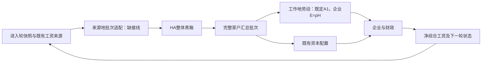

# 第五章多省份外层生产链：缺口定位与最小闭环方案

最新O3进度：[Tt/AtTax的H聚合采纳与独立实现](CH5_O3_HOUSEHOLD_FISCAL_IMPLEMENTATION_20261105.md)已完成。Owner采纳家户Tt/AtTax保持、财政边界各乘同源H一次；13项玩具工程检查通过，只新增模块/测试，已有科学源码和HA未改、实际科学调用0。模型内部聚合口径不再待选；真实单位/来源资格、完整财政及O3组合仍未建立。

DATE=2026-11-05
OWNER_CONTINUATION=可以，请继续
ACTIVE_RESEARCH_MAINLINE=PYTHON_MULTI_PROVINCE_HANK_OUTER_CLOSURE
STATUS=COMPLETED_BOUNDED_STATIC_MAPPING_AND_PLAN__NOT_IMPLEMENTED_OR_RUN
AUDITED_MODEL_HEAD=b2d95d07195295d1e3a854f9c793376482da0c39
SOURCE_BASE=56447829ce0e6c3c85552c53c351b26a2452a4bd
HA_POLICY=COMPLETE_IMMUTABLE_BLACK_BOX

## 结论与范围

外层一轮计算、工资聚合、企业、资本配置和迭代控制器均已存在。当前缺的是把已选净工资HA入口与这些外层模块接成同一条生产链，并明确劳动/财政及均衡目标的外部经济口径。无需重写HA，也无需继续研究其内部算法。

本轮完成选定工作树的代码定位、调用边核对及后续任务分解；只读源码/AST和必要既存文档，未导入项目、NumPy或SciPy，未加载真实数据/科学数组，未运行模型或测试。列出的已有测试仅代表测试文件存在，不沿用旧通过数作为本轮结果。默认0子代理。

下表路径和行号绑定上述审计HEAD，均为本地源码定位，不提供未推送代码的GitHub源码链接。HA的HJB/KFE/原汇总整体引用Kaplan、Moll和Violante（2018），本轮不解释或核验其内部数值算法。

## 已接通／缺接线／待Owner经济口径矩阵

| 环节 | 已核事实与精确入口 | 分类及下一处理 |
| --- | --- | --- |
| 省序与批次 | `src/ch5_two_asset_hank/multi_province/province_contracts.py:19`约束31省固定轴；`src/ch5_two_asset_hank/multi_province/one_turn.py:59`接收Ct、家户Lt、At、Bt、AtTax及原收敛标记 | 已有可复用数据结构；通用批次本身没有完整的生成期次/来源快照/工资见证绑定，需外部数据契约补齐 |
| 一轮外层 | `src/ch5_two_asset_hank/multi_province/one_turn.py:194`已接劳动→资本→企业→新工资→货币→财政 | 旧链已接；直接调用旧劳动函数，并未接工作地税候选。保留为历史源链，不将改名等同接线完成 |
| 迭代入口 | `src/ch5_two_asset_hank/multi_province/stationary_runtime.py:35`接受household_solver，但一轮函数硬接旧run_source_faithful_one_turn | 可复用控制流程和记录格式；净工资新链尚无独立组合入口，不能只替换HA回调就声称完成 |
| 旧HA批量入口 | `validators/multi_province/mp4b_python_empirical.py:322`与`validators/multi_province/mp4c_python_annual_production.py:145`仍用旧初始化及同时传state.tau/state.w的HouseholdInputs | 与已选净工资接口不同；不能执行旧年度runner来代替新线。这里是接口差异定位，不新增单税或经济误差的数值结论 |
| 新HA单来源入口 | `validators/multi_province/temp31_first_origin_worker.py:263`固定numerical_bootstrap19和origin_index=0；`validators/multi_province/temp31_first_origin_worker.py:96`串接原HA阶段 | 仅有已关闭的单来源诊断编排，不是多来源批次工厂；不复用/改写7/7监督器或复制HA算法来拓展 |
| 首轮/后轮净工资 | `src/ch5_two_asset_hank/multi_province/temp31_ha_taxfree_bootstrap.py:80`已有首轮数值初猜；`src/ch5_two_asset_hank/multi_province/temp31_ha_taxfree_bootstrap.py:95`和`src/ch5_two_asset_hank/multi_province/temp31_ha_wage_debug.py:161`限定旧合成见证 | 首轮19保持数值初猜资格；真实后轮输入尚无兼容通道。此后轮资格问题不由新建外部标签自动解决 |
| 工资生产 | `src/ch5_two_asset_hank/multi_province/wage.py:11`已按目的地税及迁移楔子生成各来源地净综合工资；后轮合同要求生成t→进入t+1 | 算术函数已有；缺该轮实际状态、输入/返回及消费上下文之间的生产交接。旧一次合成工资观测不可重新标成现场生产 |
| 劳动映射 | `src/ch5_two_asset_hank/multi_province/migration_labor.py:98`仍按来源地税；`src/ch5_two_asset_hank/multi_province/temp31_worksite_tax.py:106`与`src/ch5_two_asset_hank/multi_province/temp31_worksite_tax.py:115`为独立候选 | 工作地税候选缺生产接线；已恢复Owner的A1决定：消费核保持、企业劳动E=pH、家庭H不变；A2未选。实际p/工时/效率及收入兼容证据仍未闭合，不能归一化 |
| 资本与收益 | `src/ch5_two_asset_hank/multi_province/capital_allocation.py:70`输入家户At、N、inter_province_ratio及旧企业ra，不含Bt | 旧一轮内已接。未来显式记录其输入/输出单位及旧ra→新rah的时序，不自动切换双边资本网络或修改公式 |
| 企业/工资税收入 | `src/ch5_two_asset_hank/multi_province/firm.py:44`已计算企业价格与收入，其工资税项当前为Lt×tau；`src/ch5_two_asset_hank/multi_province/temp31_worksite_tax.py:199`中的tau×wjt×Lt仅为条件诊断 | 企业函数已有；Owner已采纳tau×当前企业输出gross工资×已聚合A1劳动，独立子账14项检查通过。Tt/AtTax内部各乘H一次也已获采纳并独立实现；实际生产劳动/金额物理单位、来源资格及完整财政仍待证，旧正式Govinc未替换 |
| 下一轮反馈 | `src/ch5_two_asset_hank/multi_province/steady_state.py:147`已有新w、rb、rah、企业状态写回；旧runner在HA回调内更新phi并依靠共享数组供一轮使用 | 反馈骨架已有；新链应显式绑定当轮phi、工资生成轮次及前后快照，保持既定时序，不凭隐式共享数组声称身份闭合 |
| 停止与经济目标 | `src/ch5_two_asset_hank/multi_province/steady_state.py:172`检查KNratio变化、产出变化、家户原收敛及ra边界；`src/ch5_two_asset_hank/multi_province/steady_state.py:197`还会调整Zt/GovInv；`src/ch5_two_asset_hank/multi_province/fiscal_diagnostics.py:16`仅输出GovSurplus | 旧停止规则已实现；不能当作本章完整市场清算认证。应先明确基准拟合与均衡求解的目标、内生量及残差，不自动改控制器或令财政差额为零 |

## 最小目标链（拟议接线，尚未实现）

HA输出的Ct、有效家户Lt、At、Bt保持原汇总口径；批次适配器负责省序/期次/来源绑定，不在搬运时重复乘N、z、税或迁移楔子。AtTax是外层所需附加字段，其生成和单位须显式引用既定外层口径，不借机改变HA汇总。

不把原stub的严格资格布尔值伪造成True，也不将S01—S03保存值填进完整批次冒充当前各省返回。新工程路由结果与原科学接受字段分开。

## 后续任务与依赖：复用已有结构，直接补真实接口

已有`PreFrozenHouseholdOutputBatch`、省份轴、工资记录及历史stub合同可提供字段/拒绝条件参考。本计划不新增一轮同用途stub或重复工资观测；下一实现片围绕实际生产接口兼容，历史stub仍保留其原范围。

| 任务 | 范围与拟议文件 | 完成标准与验证 | 依赖/执行边界 |
| --- | --- | --- | --- |
| O1 真实后轮工资输入兼容 | 拟新增`src/ch5_two_asset_hank/multi_province/outer_production_wage_bridge.py`及对应测试；如Owner明确允许，仅在既有`temp31_ha_taxfree_bootstrap.py`的共享来源/类型校验增加显式生产分支 | 不继承/伪装旧合成类型，不改旧SOURCE_COMMIT或scope；不重算生产者来证明来源。旧首轮/合成分支保留；陈旧期次/错省序/上下文/来源及未知执行拒绝；数值HA定义与网格不变 | **Owner已允许纯接口适配，结构工程已完成**；具体改动/检查见最新O1记录，科学消费仍关闭。采用历史兼容方案中独立类型/显式分派的方向作可审阅候选，不先实施 |
| O2 多来源HA批次适配 | 拟新增`outer_ha_batch_adapter.py`及对应测试，复用已有完整批次字段及来源上下文，不复制HA求解 | 同一进入轮快照、一个省序，每来源恰好对应一次原HA结果；Initializer和HA消费同一净工资/价格身份；Ct/Lt/At/Bt不重复乘人口/效率/税，AtTax明确外层来源；失败不提交部分批次。工程检查可注入预给定回复，不能写成真实执行 | 依赖O1及外层单位合同；真正HA调用和实际数值检查需要前瞻有限许可，不动7/7单来源worker或其旧额度 |
| O3 工作地税外层一轮组合 | 口径确定后新增`outer_closure_one_turn.py`及对应测试，复用资本、企业、工资、货币/财政组件，保留旧one_turn | 沿既定A1显式分离企业E与家庭H，目的地税/单次扣税不重开；财政金额税基G04、旧/新状态和生成t→进入t+1分别标明；检查不重扣净工资、无静默人口放大、无隐式phi副作用；不为接线重新推导HA | A1已选，A2未选；工资税金额子合同已采纳并完成独立子账，Tt/AtTax的内部H聚合已采纳并独立实现；真实单位/来源与收入兼容仍保留。没有按现成代码自动改税基或切换资本网络。实际科学算术执行需相应许可 |
| O4 控制器与最小有界运行准备 | 拟新增命名明确的新外层控制入口，分片2—4文件；参考既有记录/更新格式而不覆盖旧年度runner | 外层调用新组合；显式记录原HA返回、各轮价格、经济汇总及退出原因。区分基准拟合与均衡目标，固定代码/输入/次数/时限/退出保护后才验证多省一轮 | 依赖O1—O3及Owner明确的均衡口径/具体运行许可；不自动保留或删除旧Zt/GovInv自适应，不把旧converged字段当完整GE |

检查点：O1接口边界已获准，窄结构兼容及拒绝行为检查已完成；后续O2/O3继续保持实际来源资格和科学运行门，不以重复的占位类型或stub建设代替推进。HA运行、工资/企业真实调用及数值验证均未在本轮启动。

## 后续真实接线前需要明确的三个事项

1. **真实后轮工资接口边界。** 当前共享校验只接受旧首轮/合成后轮来源。Owner已回答“允许纯接口适配，数值算法与网格冻结（建议）”。O1仅实施结构兼容及类型/来源分派，原科学资格门仍关闭；不把历史合成记录改标签成现场生产。该批准不等于运行许可。
2. **既定A1与未定财政金额。** 已恢复Owner选择：保留消费驱动源量核，企业劳动E=pH，家庭资产/消费/财政H不变；目的地tau_j和净工资单次应用保持，A2归一化未选。Owner随后采纳tau×当轮企业输出wjt×已聚合A1劳动作为工资税金额子合同，并完成独立子账工程。Owner随后又采纳家户Tt/AtTax在财政边界各乘同源H一次，并完成独立工程，见[实施记录](CH5_O3_HOUSEHOLD_FISCAL_IMPLEMENTATION_20261105.md)。G04真实物理单位、来源资格及收入/激励兼容仍保留，不因内部合同采纳自动关闭。
3. **基准经济的外层闭合。** 明确哪些变量用于校准，哪些用于均衡更新，是否保留旧Zt/GovInv自适应规则，以及各经济残差/停止口径。不能只把旧converged字段当作完整均衡，也不自行增加财政平衡或新阈值。

本篇静态阶段完成后，Owner已明确接口边界并完成O1结构工程，见顶部更新；A1不重开；工资税子项已采纳；Tt/AtTax内部H聚合已采纳；真实单位/来源、收入兼容与均衡事项仍保留；不重开HA内部研究，不复跑旧测试或科学观察。

## 验证、接受与保护

完成图谱发现、限定源码/AST核对、精确函数行号及提交对象身份记录；关键调用边以实际源码为准。图谱部分trace将调用误连为自身或无关append方法，故不把这些边作为已证实数据流；本轮不是完整动态依赖或运行认证。25份选定源码/测试的身份清单和定点断言、Git基线、最终提交/同步回执LOCAL_ONLY保存。

TESTS=NOT_RUN
MODEL_IMPORTS=0
SCIENTIFIC_CALLS=0
SOURCE_EDITS=0
NEW_RUN_GRANTS=0
SUBAGENTS=0

TEMP31既有7/7和Moll3/3关闭、零自动重试；旧初始化余量仍仅原8格范围。HA算法/网格/原初始化与净工资既有决定不变；旧生产兼容建议不是新的变更许可。严格reference/thresholds仍null，科学接受、consumer_ready、formal_ha_accepted、FORMAL_SOURCE_FREEZE、Results、model_activation和REAL_GE保持FALSE。

历史dirty树、原件、私有/原始数据、LOCAL_ONLY证据、索引/工作树及所有失败记录保留；R12 STOP、R13未授权、WASM六路径STOP、保护重绑定未授权与16义务不变。不修改Desktop/CUA或全局配置，不推模型分支/代码，不合并main。

路线与任务入口：[主路线图](CH5_MULTIPROVINCE_HANK_ROADMAP_CURRENT.md)、[实施计划索引](../tasks/plan.md)、[任务清单](../tasks/todo.md)。它们记录这一主线下的工程分解，不建立新的科研派单/运行授权系统。

## 后续里程碑：O2已完成工程适配

见[O2批次适配记录](CH5_OUTER_MULTI_ORIGIN_BATCH_ADAPTER_20261105.md)。20项新增与15项相关回归通过，原数值源码未改，实际科学调用0；本篇原审计HEAD/行号及静态阶段事实仍按其时点保留。此前泛称O3劳动口径待选已由[既有决定恢复](CH5_O3_LABOR_WAGE_TAX_DECISIONS_RECOVERED_20261105.md)纠正：A1已选；后续Owner已采纳工资税金额子合同，见[工资税实施记录](CH5_O3_PAYROLL_TAX_IMPLEMENTATION_20261105.md)；下一步组合已采纳工资税和家户财政子账与其它原财政金额项；实际单位/来源和收入兼容继续保留，不推导其它科学采纳。
